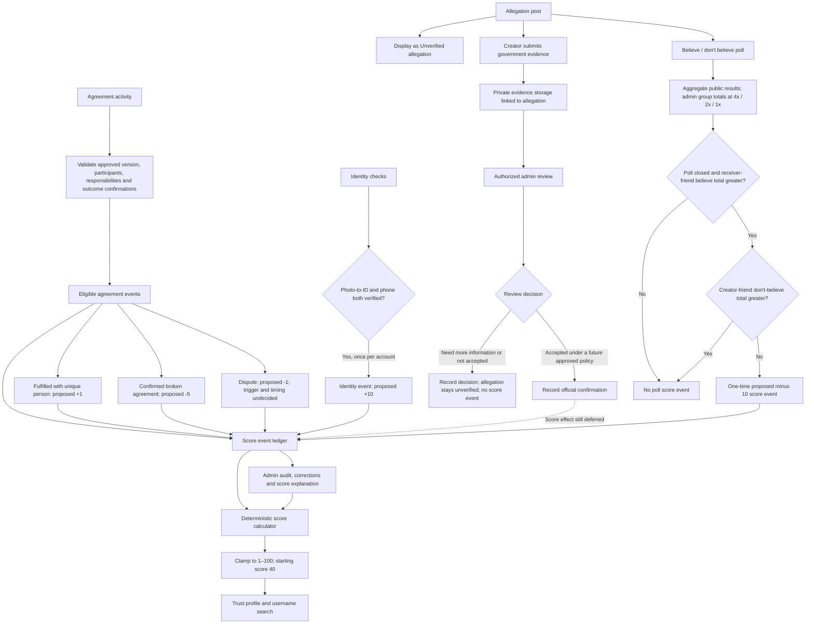

# Trust Score algorithm — working draft

**Status: discussion only. Not implemented and not used to calculate production scores.**

This document is the shared place to design, challenge, and revise the Trust Score before implementation. The intended workflow is to take a person's eligible, resolved track-record outcomes, run them through the reviewed algorithm, and use the result for the score already shown in the app. While we are designing and testing the rules, the app and its displayed score remain unchanged at the current neutral placeholder of **40/100**.

## Purpose

Show a careful, explainable record of how a person followed through on agreements made with other people in NFD. Help people make informed choices without treating a score as proof that somebody is good, bad, honest, or dishonest.

## Decisions already discussed

- The score is on a **1–100** scale; the current placeholder is **40** for every user.
- Agreement records are the score evidence unit. A **disagreement means a broken agreement**. Proposed agreement impacts are **+1 score point for fulfillment with each unique person**, **−5 points per broken agreement**, and **−1 point per dispute**. These values and their exact counting/timing rules are proposals to review, not implemented rules. Repeated agreements with the same person should not automatically earn repeated +1 awards under the current interpretation.
- Agreements are kept in NFD and include the people who need to approve them. People not yet on NFD can be invited.
- A saved agreement is versioned. A change becomes current only after all required parties approve that exact change; otherwise the previous approved version remains current.
- Track completed, delayed, partially completed, not completed, and disputed outcomes. Disagreements should be visible separately from confirmed outcomes.
- The outcome model should reflect ordinary real-world follow-through, including promises not kept and missed deadlines.
- The scoring rules and examples are to be reviewed and changed before implementation.
- Proposed identity-verification rule: award **10 points once** after the person's profile photo is verified against a government ID photo and their phone number is verified. This is a proposed rule for review; it has not been implemented.
- Proposed allegation feature: let a person publish a categorized account of alleged harmful conduct, with an explicit notice that NFD has not verified the claim. Track allegation counts separately on the creator's and named/identified recipient's Trust profiles, subject to visibility choices. The creator may post under their real NFD profile, Ghost profile, or anonymously. A creator may not tag/identify the recipient if they are not NFD friends. NFD admins may review allegation records. A poll shows aggregate results without identifying voters; admins can see aggregate counts by relationship group. Proposed vote weights are receiver's friend 4x, creator's friend 2x, and non-friend 1x. New proposal: after a poll closes, apply a one-time **−10-point** score event only if the receiver's friends' “believe” total is greater than their “don't believe” total, and the creator's friends' “don't believe” total is not greater than their “believe” total. If the creator's friends lean “don't believe,” there is no score impact. The allegation itself remains labeled unverified until the deferred government-confirmation policy is defined.
- Deferred for later discussion: what government confirmation means, whether it can change an allegation's status, and whether it should reduce the subject's score by the previously suggested **30 points**. This is not part of the current candidate algorithm.
- Proposed evidence workflow for later review: the allegation creator may submit government-confirmation evidence privately to NFD admins for review. An upload is a claim for review, not confirmation by itself; admins must record a decision before any status or score action. The government-confirmation standard and score effect remain deferred.
- Proposed Trust profile search: a person can search for an NFD username to view that person's Trust Score and the allegations received by that profile that the viewer is allowed to see. For the current proposal, allegations are displayed as **Unverified allegation**. Any future government-confirmed status or score effect is deferred until that policy is designed and reviewed.

## Proposed guardrails to review

These are recommendations for discussion, not settled product decisions.

1. Score an outcome only against the exact agreement version and responsibilities that the person approved.
2. A single party's allegation should not lower another person's score. The newly proposed −1-per-dispute rule needs a clear, fair trigger and correction rule; do not apply it from an unverified allegation or one-sided claim.
3. Ask each party to confirm the outcome. Keep confirmed outcomes distinct from pending, disputed, withdrawn, or unverified reports.
4. Record context such as mutually approved changes, deadline extensions, and partial delivery before assessing the result.
5. Treat safety reports (for example, aggressive behavior) through a separate moderation and safety process. Do not convert an unverified report into a score penalty.
6. Give participants a way to see the evidence behind their score, challenge an error, and request correction. Record corrections without exposing private agreement details to the public.
7. Do not expose agreement text, sensitive evidence, or another party's private information on a public trust profile.
8. Avoid labels such as “betrayer” or “scammer.” Present specific, qualified outcomes and the number of resolved records instead.
9. Keep allegation status distinct from score effects. An allegation remains unverified unless the deferred government-confirmation policy is defined and met. A newly proposed poll rule would reduce the score by 10 only when receiver-friend votes lean “Believe” and creator-friend votes do not lean “Don't believe”; this is a community-reaction signal, not proof, and requires strong eligibility, anti-brigading, appeal, and correction rules before any implementation.
10. Give the person described in an allegation notice, a chance to respond, and an appeal/report route. Define rules for corrections, removals, repeat submissions, and harassment before allowing public profile counts.
11. Let the author choose their post audience and disclosure mode, but treat the target's profile display preference as a separate control. A target's preference about their own profile should not silently change the author's post audience or erase the underlying admin record.
12. Restrict admin access to a documented moderation purpose, log access/actions, and avoid exposing private post content or identities to ordinary viewers when the author selected anonymous or Ghost posting.
13. Treat friend polls as community reaction, not independent verification. Friends of either side may have conflicts or coordinate votes. The proposed −10 score event requires a receiver-friend “Believe” majority and is vetoed by a creator-friend “Don't believe” majority after the poll closes; it must not change the allegation's unverified status or be described as proof. Do not expose individual voter identities; admin reporting should be aggregate by relationship group.
14. Government-confirmation status and any government-based score penalty are deferred. Allegations remain labeled unverified under the current proposal. Separate new proposal: a closed poll meeting the receiver-friend majority threshold applies one −10 score event, despite the unverified status; this exception needs explicit review and safeguards.
15. Any evidence submitted to admins must be private to authorized reviewers, linked to the relevant allegation, and handled with a defined retention/deletion policy. Do not expose evidence files publicly or treat the upload itself as proof. Record who reviewed it, the decision, rationale, and any later correction.

## Candidate scoring model (hypothesis)

Keep the model simple and auditable. Treat each **resolved agreement outcome** as one evidence item for each participant, based on that participant's own approved responsibilities. Do not award points for creating agreements or for recruiting more participants.

Possible first model to test, interpreting the user's percentages as score points on the 1–100 scale:

```text
score = clamp(1, 100,
  starting_score
  + identity_verification_bonus
  + fulfilled_unique_counterparty_points
  - 5 * eligible_disagreement_count
  - 1 * eligible_dispute_count
  - 10 * eligible_receiver_friend_poll_majority_count
)

identity_verification_bonus = 10 if all required checks pass, otherwise 0
fulfilled_unique_counterparty_points = 1 for each distinct counterparty
  with whom this person has a qualifying fulfilled agreement
eligible_receiver_friend_poll_majority_count = 1 per allegation if its closed poll
  has more receiver-friend believe votes than don't-believe votes AND the creator's
  friends do not have more don't-believe votes than believe votes, otherwise 0
```

The starting score is currently 40, so the proposed verification bonus alone would produce 50/100. Award it once per account, only when both the photo-to-ID check and phone verification pass; partial verification earns no bonus. Identity verification indicates that checks passed. It does **not** show that someone keeps agreements or behaves well, so display it as a separate verified-identity component in the score explanation rather than presenting it as agreement history.

The proposed agreement values are +1 per unique fulfilled counterparty, −5 per disagreement, and −1 per dispute. “Percent” is provisionally interpreted as percentage points (one point on the 100-point scale). The exact definitions of disagreement and dispute, confirmation/timing rules, duplicate handling, score caps, treatment of time/recency, and minimum evidence threshold are still open. For now, use the scenarios below as a paper exercise: define eligible inputs, calculate proposed results by hand or in a temporary worksheet, and compare them with the outcome we believe is fair. We should compare this additive model with a bounded/shrunk model before selecting one, so that a handful of early records cannot swing a profile to an extreme. Do not change the app's score display or implement a formula until the sample cases have expected results and the open questions have decisions.

Track a score evidence ledger for every participant: agreement ID and approved version, participant and counterparty IDs, each person's approved responsibility, outcome/dispute state, confirmations and timestamps, applied score delta, and any correction/appeal. Keep separate totals for fulfilled unique counterparties, disagreements, and disputes so the score can be explained and audited. Do not expose private agreement terms through a public score breakdown.

## Proposed architecture

The following is a design diagram only. It does not describe a currently implemented feature. Government-confirmation scoring remains deferred.



Evidence files are reviewer-only and never flow directly into the public profile. An admin decision and a score event are distinct: the score engine receives an event only after a future confirmation policy explicitly allows that event. A later correction must be recorded and recalculate the score from the ledger rather than silently overwriting history.

### Identity verification rule to test

| Condition | Proposed treatment | Review notes |
| --- | --- | --- |
| Profile photo matches the submitted government ID photo, and phone number is verified | Add a one-time 10-point identity-verification component | Confirm the photo-match method, minimum age/legal eligibility, provider, and appeal path |
| Only one of the photo/ID check or phone check passes | No bonus yet; show which check remains, without exposing the ID | TBD |
| Verification fails or is under review | No bonus; provide a correction/appeal path | TBD |
| A verified phone number or profile photo later changes | Do not silently keep claiming the old check is current; define re-verification rules | TBD |

Privacy design to review before building: prefer a verification provider that returns a pass/fail result and a reference, rather than retaining a copy of a government ID in NFD. Define deletion, access controls, retention, age eligibility, and recovery when the phone number changes before selecting a provider.

### Allegations and community polls — proposal to review

The proposed feature records categorized allegations made in posts and displays separate counts for allegations made by an account and allegations received by an account. A post must be presented as an unverified personal report; NFD must not imply that it investigated or confirmed the described conduct. The author can choose real-profile, Ghost-profile, or anonymous attribution and choose the post audience. The author cannot tag or directly identify a recipient who is not their NFD friend. Admins can access allegation records for moderation and policy enforcement.

People can search an NFD username in Trust Score and open that person's Trust profile to see the score and received allegations visible to them. Apply each allegation's audience setting when returning search results: public allegations can be seen by viewers; friends-only allegations can be seen only by eligible friends; admins can access records for moderation. Show the category and post/context when the viewer is allowed to see it. Every allegation remains labeled **Unverified allegation** until the deferred government-confirmation policy is defined and met. A separate new proposal would apply a one-time −10 score event when a closed poll has more “believe” than “don't believe” weight among the receiver's friends. This poll-triggered score event does not confirm the allegation. Never present an allegation as confirmed based only on the post, poll, or NFD admin opinion.

The proposal includes a “believe / don't believe” poll. Voters are not identified in the poll results. Admins see aggregate counts for each answer, split into receiver's friends, creator's friends, and non-friends. The proposed weight per vote is **4x** for a receiver's friend, **2x** for a creator's friend, and **1x** for a non-friend. Keep both raw group counts and weighted totals so the weighting is auditable. If someone is friends with both parties, the proposed default is to put that vote in the receiver-friend group only (4x, not 4x + 2x); confirm this precedence before implementation. Snapshot the friendship group at vote time so later friendship changes do not rewrite the poll history.

A poll measures reactions, not whether the underlying event happened. Friends can be biased, retaliatory, or coordinated, so weighted totals are not factual corroboration. New proposed rule: after the poll closes, apply **−10 points once for that allegation** only when the receiver-friends' weighted “believe” total exceeds their weighted “don't believe” total, and the creator-friends' weighted “don't believe” total does not exceed their weighted “believe” total. A creator-friend “Don't believe” majority vetoes the penalty. Since votes within each group have the same weight (4x for receiver friends; 2x for creator friends), comparisons are equivalent to strict majorities within those groups. Non-friend votes still count in the poll's overall weighted result but do not determine this proposed penalty. The allegation remains labeled unverified, and this poll result is not proof. Public results should be aggregate only and must not reveal individual voter identities; admin access is also aggregate by group, not an identity-level voter list.

The allegation creator may submit government-confirmation evidence privately to admins for review. Admins can review and record an outcome; the upload alone does not verify the allegation. Any status change or score action must wait until NFD defines and approves the government-confirmation standard and review process. The previously suggested **−30-point** reduction remains deferred and is not a current scoring rule. Before revisiting it, define what qualifies as confirmation, how identity and incident matching work, and how corrections, appeals, and duplicate reports are handled.

Visibility needs a precise model before implementation: distinguish (a) who can read the post, (b) how the author is identified, (c) whether the recipient is named or merely described, and (d) whether either party's profile shows aggregate allegation counts. The creator's post-audience choice and each profile owner's aggregate-count display preference should be independent. Admin access should be purpose-limited and auditable.

Open questions for this proposal:

- Does “allegations made / received” count every post, or only unique incidents after duplicate/edited posts are grouped?
- Can an allegation be linked to a named NFD friend, or must the target accept/confirm the link before it appears on their profile?
- Should a person who is not friends with the author be identifiable by free-text clues, and how can NFD reduce indirect identification or doxxing?
- Who may see aggregate counts, and can the creator or recipient appeal, correct, or hide the profile display without deleting the underlying moderation record?
- In username search and Trust profiles, should viewers see each audience-visible allegation with its category and status, or only aggregate counts? The current proposal is to show the visible items and their status, respecting each post's audience.
- Should a person be able to hide or limit the received-allegation section on their Trust profile while public allegation posts remain visible to their selected audience? Keep profile-section preference separate from post audience and admin records.
- Can a poll be submitted on every post, and how will one-person-one-vote, voter eligibility, coordinated brigading, ties, and vote changes work?
- Confirm the relationship precedence when a voter is friends with both parties; the draft currently assigns that voter to the receiver-friend 4x group only.
- Should public results display raw counts, weighted totals, or both? Admins should see raw counts by relationship group and the corresponding weighted totals, without voter identities.
- The new proposal uses a closed-poll strict majority among receiver's friends to trigger a one-time −10-point score event, unless creator-friend “Don't believe” votes are a strict majority, which vetoes the event. Confirm treatment of ties/no votes in either group, minimum vote counts, one-account-one-vote, vote changes, poll closure, appeals, and coordinated voting.
- Confirm that a poll-triggered −10 may affect a score while the allegation itself remains labeled unverified; decide how to explain this distinction to profile viewers and the affected person.
- What moderation standards, response window, evidence handling, retention/deletion rules, and appeals are required before public allegations launch?
- What evidence can the allegation creator submit for admin review, how will admins authenticate the source and match it to the allegation/person, what review outcomes are available, and how long should the evidence be retained?
- **Deferred:** If government confirmation is considered later, what official finding should qualify, how should identity matching, appeals, reversals, corrections, duplicate incidents, and multiple findings be handled, and should the previously suggested −30-point effect be used at all?

### Candidate outcome categories

| Record state | Candidate score treatment | Needs review |
| --- | --- | --- |
| All approved responsibilities completed as agreed | Proposed +1 point once for each distinct counterparty with a qualifying fulfilled agreement | Whether the unique-person award is once per person for the account or once per person per period; how multi-party agreements count |
| Completed late without an approved change | Potentially negative evidence, only after context and confirmation | Grace period; responsibility for delay; mutually agreed revised date |
| Partially completed | No automatic binary penalty; record the agreed and completed portions | How to assess partial progress fairly and consistently |
| Not completed | Potentially negative evidence only when the responsibility and missed result are confirmed | Excuses outside a person's control; notice and cure period |
| Parties disagree about the outcome / a dispute is recorded | Proposed −1 point per eligible dispute; do not trigger from an allegation or one-sided claim alone | Whether the point applies while unresolved or only after resolution; whether it is restored if the user prevails; define one dispute unit |
| A broken agreement (disagreement) is confirmed | Proposed −5 points per eligible broken agreement | Define confirmation, how responsibility/context are assessed, and whether the −1 dispute point is separate or replaced |
| Agreement changed and all parties approved the new version | Evaluate against the latest approved version | Whether earlier versions remain visible in the audit trail |
| Change proposed but not approved by everyone | Original approved version remains in force | How a participant can exit or pause an agreement |
| Withdrawn, cancelled, or ended by mutual consent | No automatic penalty | Define permitted cancellation states |
| Safety/aggression allegation | Separate safety/moderation workflow; the new poll rule may still apply if approved, but the allegation remains unverified | Whether safety categories should be excluded from poll-based scoring; what evidence and review process apply |

## Scenario review worksheet

Use these cases to expose unfair outcomes before choosing weights. “Expected” describes a proposed principle, not an implemented score.

| Case | Expected behavior to discuss | Decision / notes |
| --- | --- | --- |
| Both participants confirm every responsibility was completed on time | Record one completed agreement outcome per responsible participant; no bonus just for having more agreements | TBD |
| A deadline is missed, but both approve a new date before it passes; work is completed by the new date | Assess against the current approved version; preserve the old version in history | TBD |
| Deadline passes; one participant says work was not done and the other disputes it | Mark disputed; no score impact until resolved | TBD |
| A task is only partly completed and the parties disagree about what “partial” means | Keep disputed; do not guess a percentage or penalize based on one account | TBD |
| One participant has 1 completed agreement; another has 20 | Agreement volume alone should not decide who has the higher score | TBD |
| One agreement has several participants with different responsibilities | Assess each person only on the responsibilities they approved | TBD |
| A participant is accused of aggressive behavior during an agreement | Route to safety review; do not treat the allegation as a confirmed agreement outcome | TBD |
| A person joins NFD after an agreement was created elsewhere | No score evidence until identities, participation, agreement version, and outcome are appropriately confirmed in NFD | TBD |
| A participant claims an outcome record is wrong | Provide review/correction path; recalculate transparently if corrected | TBD |
| A closed allegation poll has more believe than don't-believe weight among the receiver's friends | New proposal: apply a one-time −10-point score event; leave allegation status Unverified | Minimum votes, appeals, corrections, and anti-brigading rules TBD |
| Receiver's friends lean Believe, but creator's friends lean Don't believe | New proposal: creator-friend majority vetoes the −10 event; leave allegation status Unverified | Confirm ties/no votes and minimum group sizes |
| A user has no resolved agreement records | Keep the neutral starting score and clearly label it as a starting/limited-evidence score | TBD |
| A user fulfills agreements with three distinct counterparties | Proposed +3 points total, even if there are multiple agreements with one of those same people | Confirm the unique-counterparty window and handling of multi-party agreements |
| A user receives one eligible dispute and later wins the resolution | Proposed −1 for the dispute, but whether/how to restore it remains unresolved | TBD |
| One disagreement is recorded for an agreement that was also disputed | Proposed −5 disagreement and −1 dispute are not yet defined as cumulative or mutually exclusive | Decide whether these are separate events and prevent double-counting |
| A person passes both photo-to-government-ID and phone verification | Proposed score gets one +10 identity component (40 becomes 50 before any agreement outcomes); do not treat this as completed-agreement evidence | TBD |
| A person passes only the phone check, or only the ID-photo check | No +10 until both required checks pass | TBD |

Add edge cases here before implementation, including late completion, force majeure, fraud in collusion, multiple accounts, deleted/deactivated accounts, withdrawn consent, and appeals.

## Decisions still needed

- Should the score reflect only outcomes confirmed by every participant, or can a defined neutral review resolve a disagreement?
- What counts as confirmation, and how should the app handle a participant who never responds?
- How should delays, approved extensions, partial completion, and unavoidable events be distinguished?
- Should older outcomes have less influence? If so, what time window and decay rule are understandable?
- What score movement cap applies per agreement and over a period? What minimum resolved evidence is needed before showing a changing score?
- Should the interface show only an overall score, or also a short breakdown and confidence/evidence level?
- Should the one-time +10 identity component remain in the total if verification expires, is revoked, or the account changes its photo/phone? How should re-verification work without allowing repeated bonuses?
- What verification provider can perform the photo-to-ID and phone checks while minimizing NFD's collection and retention of government-ID data?
- Which details are public, visible to friends, visible only to agreement participants, or private to the account owner?
- What appeals, corrections, and moderation review process must exist before score-impacting records launch?
- How do we prevent reciprocal-rating pressure, retaliation, coordinated manipulation, duplicate agreements, and agreements written to game the score?
- Confirm that the proposed +1, −5, and −1 are score points (percentage points), not relative percentage changes.
- Define a fulfilled agreement, unique counterparty, and dispute counting unit. “Disagreement” means a broken agreement. Decide how a broken agreement is confirmed, when a dispute causes −1, whether that point is restored after a favorable resolution, and whether a confirmed broken agreement adds −5 on top of the dispute point.
- Should a fulfilled counterparty count only once for the lifetime of the account, or can the same counterparty qualify again after a defined period or a materially different agreement?
- How do deleted accounts and retention requests affect agreement history and other participants' records?

## Change log

- **2026-11-02:** Created this discussion draft from the decisions made so far. No production algorithm or score behavior changed.
- **2026-11-02:** Added a proposed one-time +10 component for completing photo-to-government-ID and phone verification. No production algorithm or score behavior changed.
- **2026-11-02:** Deferred government-confirmation status and scoring rules, including the suggested −30-point effect, for later discussion. Until revisited, allegations remain unverified and have no allegation-based score effect.
- **2026-11-02:** Added proposed agreement impacts of +1 point per unique fulfilled counterparty, −5 per disagreement, and −1 per dispute; documented the need to define event counting and dispute timing. No production algorithm or score behavior changed.
- **2026-11-02:** Defined “disagreement” as a broken agreement for the proposed −5-point rule. No production algorithm or score behavior changed.
- **2026-11-02:** Added proposed one-time −10-point score impact when receiver-friend “believe” votes exceed “don't believe” votes after an allegation poll closes. Allegation status remains unverified; poll safeguards and implementation details remain open. No production algorithm or score behavior changed.
- **2026-11-02:** Added a proposed creator-friend “Don't believe” majority veto for the poll-based −10 score event. No production algorithm or score behavior changed.

## Review log

| Date | Cases reviewed | Changes agreed | Still open |
| --- | --- | --- | --- |
|  |  |  |  |
